# Agentic Reliability Harness 🛡️⚡

[](https://github.com/thiagocoghi/agentic-reliability-harness/actions)
[](https://www.python.org/)
[](https://opensource.org/licenses/MIT)
[](https://github.com/astral-sh/ruff)
[](#benchmark--evaluation-metrics)

> **Production-grade AI agent reliability harness featuring circuit breakers, deterministic state machines, strict Pydantic v2 tool boundary validation, and automated CI/CD evaluation suites for multi-turn LLM workflows.**

---

## The Problem: Why Autonomous AI Agents Break in Production

While single-turn LLM demos are easy to build, deploying multi-turn autonomous agents into production introduces distributed systems chaos:

1. **Compounding Error Rates:** In an agent taking a 20-step trajectory, even a $99\%$ per-step tool execution rate yields only $(0.99)^{20} \approx 81.7\%$ overall task success.
2. **Runaway Loops & Token Burn:** Without strict deterministic cycle detection, agents stuck on unexpected API responses retry indefinitely, consuming monthly token budgets in hours.
3. **Tool Misuse & Unsafe Execution:** Passing unvalidated inputs to backend APIs risks injection attacks and state corruption.
4. **Lack of CI/CD Regression Testing:** Traditional software uses deterministic unit tests (`assert f(x) == y`). AI agents require continuous evaluation against golden datasets to block regressions before merging pull requests.

This harness demonstrates how to solve these challenges with production reliability engineering patterns.

---

## Architecture & Guardrail Topology

```mermaid
flowchart TD
    subgraph Agentic_Harness["Agentic Reliability Harness"]
        Input["User Request (FinOps Discrepancy)"] --> Router["StateGraph Router Node"]
        Router --> Guardrail["Guardrail & Token Budget Check"]
        
        Guardrail -->|Budget OK & No Loops| ToolNode["Strict Pydantic Tool Executor"]
        Guardrail -->|Loop Detected / Budget Cap| CircuitBreaker["Circuit Breaker (Graceful Degradation)"]
        
        ToolNode -->|Downstream 429 / 504| RetryManager["Exponential Backoff & Rate Limit Handling"]
        RetryManager --> Evaluator["Response Synthesizer"]
        ToolNode -->|200 OK Execution| Evaluator
        CircuitBreaker --> Evaluator
        
        Evaluator --> Output["Deterministic Structured Audit Report"]
    end

    subgraph CI_CD_Evals["Automated CI/CD Quality Gate (GitHub Actions)"]
        PR["Pull Request Created"] --> Pytest["DeepEval / Pytest Suite"]
        GoldenDS[("Curated Golden Dataset")] --> Pytest
        Pytest --> QualityGate{"Pass Thresholds?<br>(Accuracy >= 95%)"}
        QualityGate -->|Pass| AllowMerge["Allow PR Merge ✅"]
        QualityGate -->|Fail| BlockPR["Block Merge & Alert CTO ❌"]
    end
```



---

## Key Features

- **⚡ Deterministic Circuit Breaker:** Detects duplicate repetitive tool calls, max iteration boundaries, and token budget limits before API costs escalate.
- **🔒 Strict Pydantic v2 Schema Enforcement:** Validates every tool argument prior to downstream API invocations, rejecting malformed identifiers with informative error diagnostics.
- **🔄 Fault-Tolerant API Retry Strategy:** Gracefully handles downstream HTTP 429 (Rate Limits) and HTTP 504 (Gateway Timeouts) without crashing the agent process.
- **🧪 Golden Dataset CI/CD Gate:** Automated test suite (`evals/`) executing in GitHub Actions on every Pull Request to ensure behavioral zero-regression.
- **📊 Observability & Forensic Trail:** Complete audit telemetry tracking every intermediate thought, tool invocation, HTTP status code, and latency timestamp.

---

## Benchmark & Evaluation Metrics

The repository includes a benchmark suite verifying agent behavior against adversarial scenarios:

| Test Scenario | Challenge / Chaos Injected | Expected Outcome | Harness Status |
| :--- | :--- | :--- | :---: |
| **CASE-01: Discrepancy Audit** | Subtle \$300 ledger discrepancy between invoice and payment gateway | Identify mismatch, execute forensic tool chain, flag audit ledger | **PASS (100%)** |
| **CASE-02: Clean Reconciliation** | Matched invoice and gateway records | Verify balance without false-positive flags | **PASS (100%)** |
| **CASE-03: Schema Injection** | Malformed invoice identifier format | Intercept at Pydantic boundary, 0 tools called | **PASS (100%)** |
| **CASE-04: API Rate Limit (429)** | Downstream payment gateway 429 throttle | Bounded retry, graceful degradation, zero unhandled exceptions | **PASS (100%)** |
| **CASE-05: Adversarial Loop** | Circular dependency forcing repetitive calls | Circuit breaker trips within 2 iterations | **PASS (100%)** |

---

## Quickstart (Under 60 Seconds)

### 1. Clone the repository
```bash
git clone https://github.com/thiagocoghi/agentic-reliability-harness.git
cd agentic-reliability-harness
```

### 2. Set up virtual environment
```bash
python -m venv venv
# Linux / macOS:
source venv/bin/activate
# Windows:
.\venv\Scripts\Activate.ps1
```

### 3. Install dependencies
```bash
pip install -r requirements.txt
```

### 4. Run the CI evaluation test suite
```bash
pytest evals/ -v
```

All 9 test cases will execute deterministically in **< 0.15 seconds** with zero external API dependencies required.

---

## Project Structure

```
agentic-reliability-harness/
├── .github/
│   └── workflows/
│       └── ai-evals-ci.yml           # CI/CD GitHub Actions quality gate
├── agent/
│   ├── __init__.py                   # Package exports
│   ├── circuit_breaker.py            # Loop detection & budget guardrails
│   ├── graph.py                      # StateGraph agent controller & execution loop
│   ├── state.py                      # Pydantic AgentState and ToolCallRecord definitions
│   └── tools/
│       ├── __init__.py
│       ├── billing_tools.py          # Strict Pydantic tool schemas
│       └── mock_payment_api.py       # Deterministic API with failure injection
├── evals/
│   ├── __init__.py
│   ├── golden_dataset.json           # Curated test cases & edge scenarios
│   ├── test_agent_reliability.py     # End-to-end agent reliability evals
│   └── test_circuit_breaker.py       # Unit tests for guardrail trips & fallbacks
├── .env.example                      # Environment configuration template
├── .gitignore
├── pyproject.toml                    # Pytest and package build configuration
├── requirements.txt                  # Production and testing dependencies
└── README.md                         # Architecture, documentation, and benchmarks
```

---

## Author & Engineering Profile

**Thiago Coghi**  
*Senior SDET & AI Systems Reliability Engineer*  
- **Background:** Software Engineer in Test (SDET) specializing in AI Copilot platforms (RAG, intent recognition, agent routing), test automation frameworks, and closed-loop control engineering.
- **Certifications:** Claude Architect Foundations, Claude Code Foundations, Prompt Engineering (CI&T Academy).
- **GitHub:** [@thiagocoghi](https://github.com/thiagocoghi)  
- **Email:** thiagocoghi@hotmail.com

---

## License

This project is licensed under the MIT License - see the [LICENSE](LICENSE) file for details.
